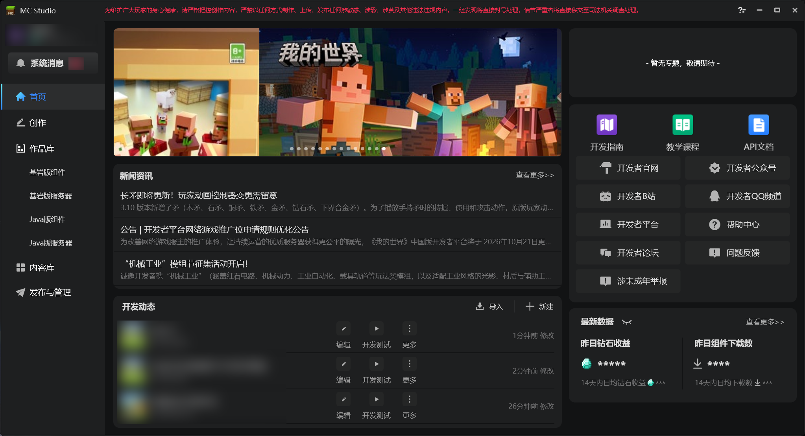

  
  <h1>MCSTestHelper</h1>
  
<strong>我的世界 MCStudio 自测助手</strong>

  
面向 Minecraft 地图与附加包创作流程的本地辅助工具

  
🎮 Minecraft　·　🧱 MCStudio　·　🗺️ 地图　·　🧩 附加包　·　✅ 自动自测

---

MCSTestHelper 帮助《我的世界》MCStudio 创作者简化项目保存、发布和自测流程。程序通过 MCStudio 桌面界面执行操作；开始前请先登录 MCStudio，并确认项目与作品 ID 对应正确。

## 功能

- 支持 **地图（Map）** 和 **附加包（AddOn）** 项目。
- 一键保存项目、更新发布作品并启动自测。
- 每个项目可单独绑定以 `46` 开头的作品 ID。
- 可为项目设置发布匹配关键词，解决本地项目名与 MCStudio 作品名不同的问题。
- 可在项目设置中选择“免机审自测”或“机审自测”，每个项目独立保存。
- 可配置 MCStudio 工作目录和任务快捷键。
- 检测到作品正在自测或审核时会停止当前流程。

## 使用

1. 在 Windows 上安装并登录 MCStudio。
2. 将仓库目录放在固定位置，双击 `Start-Ui.vbs` 启动助手。
3. 点击标题栏里的 **设置**，选择 MCStudio 工作目录。默认目录是 `D:\MCStudioDownload\work`。
4. 选中项目，在项目设置里绑定该作品的 46 ID，并选择自测方式。
5. 点击绿色 ▶ 开始保存、发布和自测；运行时点击红色 ■ 停止。

> 工作目录只需包含 MCStudio 账号文件夹，项目会由软件自动查找。

开始任务前，请让 MCStudio 保持在首页的“开发动态”界面（如下图）即可；可以退至后台，无需一直置于前台。

## 环境要求

- Windows
- Windows PowerShell 5.1（系统自带）
- MCStudio 已安装并登录

## 项目文件

- `Start-Ui.vbs`：隐藏控制台并启动图形界面。
- `Publish-Ui.ps1`：项目列表、设置和快捷键界面。
- `Publish-SelfTest.ps1`：保存、发布和启动自测的自动化流程。
- `MCSTestHelper.ico` / `MCSTestHelper.png`：Minecraft 风格程序图标。

配置与运行日志保存在本地，不提交到仓库：`ui-config.json`、`last-run.log`、`run-progress.txt`。

## 注意

自动化依赖 MCStudio 当前版本的界面和控件。开始任务前，请确认选择的项目、绑定的作品 ID 和工作目录正确，并让 MCStudio 保持在上图所示的首页“开发动态”界面（可以退至后台）。任务运行期间请勿移动鼠标，以免打断自动操作。

发布网页由 MCStudio 的发布操作调起；助手不会强制使用 Edge，并会识别 Edge、Chrome 和 Firefox 窗口。实际使用哪个浏览器取决于 MCStudio 的调用方式及系统浏览器设置。

若项目没有出现在本软件的“开发动态”列表里，可在 MCStudio 中进入“作品 → 更多 → 配置 → 全部升级”，完成后刷新列表，让软件识别该项目。

  为 Minecraft MCStudio 创作流程制作 · 作者 FxShadow

